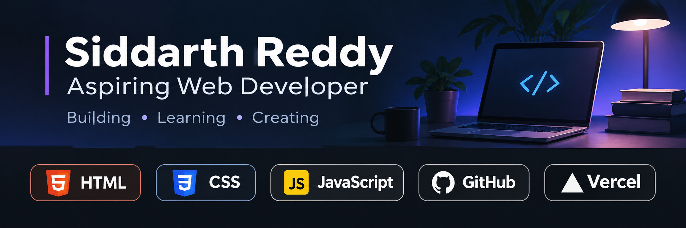

  

Hi, I'm Siddarth Reddy 👋

I'm an aspiring web developer from India, currently pursuing my undergraduate studies at Mohan Babu University.

I'm learning web development by building projects and exploring new technologies. I enjoy creating websites and turning ideas into working applications.

## 🚀 My Projects

### Focus Timer
A productivity website that helps users manage focus sessions, breaks, and hydration.

- [Live Website](https://focus-timer-eta-ten.vercel.app/)
- [View Source Code](https://github.com/iloveappleswarm-hue/focus-timer)

## 💻 Technologies I'm Learning

## 🌱 Currently Learning

- Building interactive websites
- Improving my web development skills
- Using GitHub to manage and showcase my projects

## 📫 Connect With Me

- GitHub: [@iloveappleswarm-hue](https://github.com/iloveappleswarm-hue)
- Email: siddarthr256@gmail.com

I'm open to learning opportunities, internships, and entry-level remote tech roles.
